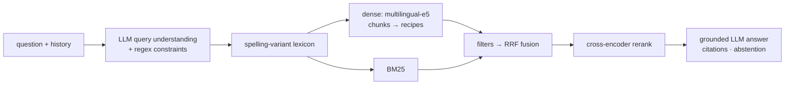

# 🍲 Moroccan-aware Recipe RAG

A recipe assistant that answers in **French, English or Moroccan Darija**, grounded in
**235k recipes** (Food.com + a Moroccan recipes dataset), with hybrid retrieval, a
corpus-mined spelling-variant lexicon for Darija dish names, LLM query understanding,
cross-encoder reranking, cited answers and an evaluation suite.

> v1 was a first-year engineering school project (ENSIAS). v2 is a measured rebuild: every
> component below exists because it improved a benchmark, and the benchmark is in the repo.
> Full write-up: **[docs/TECHNICAL_REPORT.md](docs/TECHNICAL_REPORT.md)** · pitch and
> interview notes: **[docs/PITCH.md](docs/PITCH.md)**.

## Results

| | v1 | v2 |
|---|---|---|
| Retrieval nDCG@10 (74-query benchmark) | 0.423 | **0.832** |
| Hit@5 (a fully relevant recipe in the top 5) | 62% | **100%** |
| Darija-spelled queries (tanjia, bstilla, rafissa…) | 0.095 | **0.770** |
| Moroccan dishes asked in French | 0.139 | **0.795** |
| Answer faithfulness (LLM judge, 1-5) | 2.08 | **4.08 - 4.50** |
| Correct "not in my database" on unanswerable questions | 0 / 7 | **7 / 7** |

Full ablation (each component's contribution), chunking experiment and answer evaluation:
[docs/TECHNICAL_REPORT.md](docs/TECHNICAL_REPORT.md#9-results).

## What changed from v1

| | v1 | v2 |
|---|---|---|
| Moroccan recipes indexed | 1,927 (parser bug + name-only dedup) | **3,829** (3 step formats parsed) |
| Embeddings | all-MiniLM-L6-v2 (English), whole recipe, 34% truncated | multilingual-e5-small, overview chunks (chunking chosen by experiment) |
| Lexical search | none | BM25 + Reciprocal Rank Fusion |
| Darija spellings | hard-coded dict (measured: slightly harmful) | lexicon mined from the corpus (tanjia → tangia) |
| Query understanding | none | LLM structured output grounded with corpus spellings (English rewrite, filters, follow-ups) + regex rules |
| Reranking | none | multilingual cross-encoder |
| Answer | top-2 recipes, "use your general knowledge, don't mention it", T=0.9 | 4 full recipes, citations, abstention when not found, T=0.3 |
| Evaluation | manual tries | 81-query benchmark, ablations, LLM-as-judge |
| Engineering | 1 GB reloaded per request, unsalted SHA-256, debug on 0.0.0.0 | load once, scrypt + migration, safe defaults, model fallback, 38 tests + CI |

## Architecture



## Quickstart

```bash
python -m venv .venv
.venv\Scripts\activate                     # Linux/macOS: source .venv/bin/activate
pip install torch --index-url https://download.pytorch.org/whl/cpu
pip install -r requirements.txt
copy .env.example .env                     # then set GROQ_API_KEY and FLASK_SECRET_KEY
```

Data (not in the repo, see `data/`): put `RAW_recipes.csv`
([Food.com](https://www.kaggle.com/datasets/shuyangli94/food-com-recipes-and-user-interactions))
and `moroccan_recipes_dataset.csv`
([Moroccan recipes](https://www.kaggle.com/datasets/idrisskh/moroccan-recipes-dataset)) in
`data/raw/`, then build the indexes (≈2.5 h on a laptop CPU, resumable; or a few minutes on a
free Colab GPU with `scripts/colab/`):

```bash
python -m recipe_rag.build_index
python app.py                              # http://127.0.0.1:5000
```

Without an API key the app still runs in retrieval-only mode (it lists the best recipes).

## Evaluation

```bash
python -m eval.build_qrels                 # resolve relevance rules into qrels
python -m eval.evaluate_retrieval          # ablation study -> eval/results/
python -m eval.chunking_experiment         # chunking strategies
python -m eval.evaluate_generation         # faithfulness / abstention (LLM judge)
pytest                                     # 38 unit tests, no index or key needed
```

## Project structure

```text
recipe_rag/     ingestion, chunking, dense + BM25 indexes, lexicon, query understanding,
                hybrid retriever, reranker, prompts, assistant, LLM client, v1 baseline
eval/           benchmark (queries.yaml), judge + metrics, experiments, results/
tests/          unit tests
app.py          Flask app (auth, chat with memory, sources, history)
templates/      UI
docs/           technical report, pitch
notebooks/      v1 exploration (history)
```

## Authors

Mohamed Amine Tarik · Mohamed Oussama Rafiq (v1, supervised by Prof. H. Benbrahim, ENSIAS).
v2 rebuild by Mohamed Amine Tarik.
