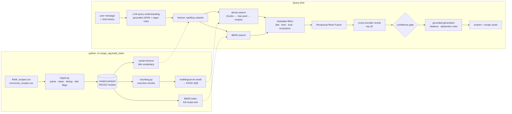

# Moroccan-aware Recipe RAG: technical report (v2)

> A retrieval-augmented recipe assistant for Moroccan and international cuisine.
> v1 was the original prototype; v2 is a rebuild driven by measurement: a labelled
> benchmark, an ablation study, and a fix for every failure the benchmark exposed.

## Results at a glance

Benchmark of 74 labelled queries (+7 unanswerable), same judge for every system.

| | v1 | v2 |
|---|---|---|
| Retrieval nDCG@10 | 0.423 | **0.832** |
| MRR@10 / Hit@5 | 0.547 / 0.622 | **0.920 / 1.000** |
| Darija-spelled queries (nDCG@10) | 0.095 | **0.770** |
| Moroccan dishes asked in French | 0.139 | **0.795** |
| Ingredient-based questions | 0.394 | **0.817** |
| Answer faithfulness, LLM judge (1-5) | 2.08 | **4.08 - 4.50** |
| Answers with no unsupported recipe fact | 4% | **32% - 57%** |
| "I don't have this recipe" on unanswerable questions | 0 / 7 | **7 / 7** |
| Moroccan recipes indexed | 1,927 | **3,829** |

The "tanjia" query now returns the one *Moroccan Tangia Marrakchia* recipe of the corpus at
rank 1 and the answer is that recipe, cited; v1 retrieved lamb stews and invented a tagine.

---

## Table of contents

1. [Context and goal](#1-context-and-goal)
2. [Audit of v1: what was actually wrong](#2-audit-of-v1-what-was-actually-wrong)
3. [v2 architecture](#3-v2-architecture)
4. [Data pipeline](#4-data-pipeline)
5. [Chunking strategy](#5-chunking-strategy)
6. [Retrieval](#6-retrieval)
7. [Generation and hallucination control](#7-generation-and-hallucination-control)
8. [Evaluation methodology](#8-evaluation-methodology)
9. [Results](#9-results)
10. [Case study: the "tanjia" problem, end to end](#10-case-study-the-tanjia-problem-end-to-end)
11. [Difficulties and how they were solved](#11-difficulties-and-how-they-were-solved)
12. [Design decisions and rejected alternatives](#12-design-decisions-and-rejected-alternatives)
13. [Web application and engineering](#13-web-application-and-engineering)
14. [Limitations and future work](#14-limitations-and-future-work)
15. [How to reproduce](#15-how-to-reproduce)

---

## 1. Context and goal

Users ask in **French, English or Moroccan Darija** for recipes ("comment faire une tanjia ?",
"j'ai du poulet et des citrons confits", "un plat végétarien en moins de 30 minutes").
General-purpose LLMs answer confidently but invent regional recipes, so the assistant must
**ground every answer in a recipe database** and say so when the database has nothing.

Knowledge base (two Kaggle datasets):

| Source | Raw rows | After cleaning | Content |
|---|---|---|---|
| Food.com *Recipes and Interactions* | 231,637 | 230,783 | international recipes, tags, time, nutrition |
| Moroccan recipes dataset | 4,627 | 3,829 | scraped Moroccan recipes, free-text format |
| **Total** | | **234,612** (4,120 Moroccan incl. 291 Food.com recipes tagged *moroccan*) | English text |

Two properties of this corpus drive most design decisions:

* **The corpus is English, the users are not.** A French question must match an English recipe.
* **Moroccan recipes are 1.8% of the corpus.** For any Moroccan query, 230k Food.com recipes
  act as distractors ("lamb stew" is everywhere; "tangia" is in one recipe).

## 2. Audit of v1: what was actually wrong

v1 = `all-MiniLM-L6-v2` embedding of each whole recipe, FAISS, top-2 recipes, Llama-4 via
Groq, plus a hard-coded query-expansion dictionary for Moroccan words. The report attributed
the "tanjia" hallucination to the embedding model not knowing Darija. Instrumenting the
pipeline showed **six independent causes**:

| # | Finding | Evidence | Effect |
|---|---|---|---|
| 1 | **The dish is spelled differently in the data.** | "tanjia" occurs 0 times in the corpus; "tangia" occurs 5 times (one actual recipe). | No lexical or semantic match is possible from the user's spelling. |
| 2 | **Half of the Moroccan data was lost before indexing.** | The Moroccan file stores steps in 3 formats (Python list: 3,885 rows, dict of sections: 56, `\|`-separated text: 628). The v1 parser only read lists, then rows with empty steps were dropped; deduplication by *name only* merged every "Moroccan Chicken" into one. | v1 indexed **1,927** Moroccan-dataset recipes; v2 indexes **3,829** (×2). |
| 3 | **English-only embeddings for French queries.** | `all-MiniLM-L6-v2` is trained on English. | French queries are matched on surface sub-words, not meaning. |
| 4 | **Silent truncation.** | MiniLM reads 256 tokens; measured on 5,000 v1 documents: **33.9%** are longer (median 222, p90 362 tokens). | The end of a third of the recipes (often the whole method) never reached the index. |
| 5 | **The prompt licensed hallucination.** | *"If the recipes do not fully address the question, you may use your general culinary knowledge (don't mention that you have used your general knowledge)"*, temperature 0.9. | When retrieval failed, the model was told to invent and hide it. |
| 6 | **The hard-coded expansion did not help.** | Measured on the benchmark (section 9): v1 with expansion nDCG@10 = 0.423, without = 0.426 (and it is non-deterministic: the query is rebuilt from a Python `set`). | It injected generic words ("stew", "lamb") that pull in American stews. |

Engineering issues found on the way: the 685 MB metadata CSV, the 356 MB index and the model
were **reloaded on every request**; passwords were **unsalted SHA-256** (the comment said
"with salt"); the Flask debugger was enabled on `0.0.0.0` (remote code execution); CORS
allowed any origin with credentials; chat messages were inserted as raw HTML (XSS).

## 3. v2 architecture



Code layout:

```text
recipe_rag/
  config.py               every tunable in one place (env-overridable)
  ingest.py               raw CSVs -> one clean table (3 step formats, dedup, diet inference)
  chunking.py             structure-aware chunks (overview / method), BM25 document
  dense.py                Embedder (E5 prefixes) + FAISS index
  sparse.py               BM25 (bm25s) with bilingual stopwords
  lexicon.py              corpus-derived spelling-variant lexicon (replaces hard-coded dict)
  query_understanding.py  LLM structured output + rule-based constraints + fallback
  retriever.py            hybrid search, filters, RRF, reranking, confidence
  reranker.py             cross-encoder
  prompts.py              grounded-generation prompt, citation format, canned answers
  assistant.py            end-to-end orchestration, retrieval-only fallback
  llm.py                  thin Groq client (timeouts, retries, JSON schema mode, model fallback)
  legacy.py               v1 retrieval + generation, kept as the evaluation baseline
  build_index.py          offline pipeline CLI (resumable, cached embeddings)
eval/
  queries.yaml            81 labelled queries (rules, not hand-picked IDs)
  judge.py                relevance rules + IR metrics
  evaluate_retrieval.py   ablation study
  chunking_experiment.py  chunking strategies compared
  evaluate_generation.py  LLM-as-judge: faithfulness, relevance, abstention
tests/                    38 unit tests (no index or API key needed)
scripts/colab/            optional GPU offload of the embedding step (Colab notebook)
app.py, templates/        Flask app
```

## 4. Data pipeline

`recipe_rag/ingest.py` turns both datasets into one table with a common schema
(`recipe_id, source, name, description, ingredients[], steps[], tags[], minutes, calories,
nutrition…, is_moroccan, is_vegetarian, is_vegan, is_gluten_free`).

* **Robust parsing of the Moroccan file.** Each row is free text
  (`Recipe Name : … Ingredients : [...] Total time for preparation : … Steps for preparation : …`).
  Sections are split on the known keys; list fields are parsed from Python literals, dicts of
  sections (flattened in order) or `|`-separated text, with a regex fallback for truncated
  literals and a fallback to the `completion` column. Non-recipe rows ("Top 10 foods to try
  in Morocco: …") are dropped. Description and total time, discarded by v1, are kept.
* **Deduplication on (normalised name + ingredient set)**, not name alone: two "Moroccan
  Chicken" recipes with different ingredients are different recipes. 1,591 exact duplicates
  removed (mostly the same page scraped several times).
* **Outliers**: cooking times above 30 days and calories above 5,000 kcal/serving are set to
  missing (Food.com contains `minutes = 2,147,483,647`).
* **Dietary flags inferred from ingredients**, the same way for both sources (the Moroccan
  file has no tags, Food.com tags are incomplete). Conservative rules: any meat/fish word
  (including "chicken broth") → not vegetarian, unless qualified as plant-based ("vegetable
  stock", "vegetarian sausage"); dairy/eggs/honey → not vegan, with exceptions ("peanut
  butter", "coconut milk", "eggplant"); gluten keywords minus gluten-free variants ("rice
  flour"). Food.com's explicit *gluten-free* tag is also trusted. These flags power the
  metadata filters; they are heuristics and documented as such.

## 5. Chunking strategy

**Problem.** v1 embedded each recipe as one string; a third of them were truncated by the
256-token window. The textbook fix, fixed-size overlapping windows, ignores the fact that a
recipe is already structured: a 100-word window cuts an ingredient list in half or glues the
end of step 4 to the beginning of step 5, and each window loses the recipe title.

**Design: structure-aware chunks + parent-document retrieval.**

* One **overview** chunk per recipe: title, first 60 words of the description, informative
  tags, full ingredient list. This is what people search by (dish name, ingredients, cuisine,
  diet). Median 115 tokens, p99 209: it always fits the 512-token window of e5.
  Food.com tags present in more than 15% of recipes ("preparation", "time-to-make",
  "course"…) and time/size tags (handled as structured filters) are removed: they add noise
  to every vector and carry no signal.
* **Method** chunks: consecutive steps packed up to 180 words, never cutting a step, each
  prefixed with a *contextual header* ("How to make Moroccan Tangia (steps 1-4 of 9):") so a
  chunk is still meaningful on its own.
* **Retrieval is on chunks, the answer is on recipes**: chunk scores are max-pooled into a
  recipe score and the LLM always receives the complete parent recipe (ingredients + all
  steps), never a fragment.
* **BM25 indexes the full recipe text** (one document per recipe): it has no context window,
  and its length normalisation handles long documents. The title is repeated once, a cheap
  field boost (BM25F-style).

**Experiment** (`eval/chunking_experiment.py`): dense retrieval only, so chunking is the
only variable, on a 20,247-recipe sub-corpus (all Moroccan recipes + up to 40 relevant
recipes per query + 15k random distractors; 66 non-constraint queries).

| Strategy | Vectors | nDCG@10 | MRR@10 | Hit@5 |
|---|---|---|---|---|
| A. Whole recipe, MiniLM (v1) | 20,247 | 0.555 | 0.705 | 0.788 |
| B. Whole recipe, e5 | 20,247 | 0.727 | 0.850 | 0.879 |
| C. Fixed 100-word windows (25 overlap), e5 | 48,577 | 0.715 | 0.826 | 0.955 |
| D. Overview chunk, e5 | 20,247 | 0.717 | **0.872** | **0.970** |
| E. Overview + method chunks, e5 | 43,602 | **0.731** | 0.838 | 0.939 |

On the full corpus, inside the complete pipeline, adding method chunks **lowered** nDCG@10
from 0.828 to 0.792 (measured twice with different code versions: same conclusion).

**What this taught me** (and the decision):
* The embedding model mattered far more than the chunking (A → B: +0.17). With a 512-token
  window, truncation stops being the bottleneck, so the chunking strategies end up within
  ~0.015 nDCG of each other, which is noise on 66 queries.
* Structure-aware overview chunks give the best *early precision* (MRR, Hit@5), which is
  what a RAG system feeding 4 recipes to an LLM needs, with 2.4× fewer vectors than
  windows. Method chunks add vectors that mostly match generic instructions ("simmer for 20
  minutes") and pull in noise; their small sub-corpus gain disappears on 235k recipes.
* **Production: overview chunks only** (235k vectors), BM25 on the full text for words
  that only appear in the method. A negative result, kept because measuring it is how the
  decision was made.

## 6. Retrieval

### 6.1 Multilingual dense embeddings

`intfloat/multilingual-e5-small` (118M parameters, 384 dimensions, 512-token window, trained
on ~100 languages) replaces `all-MiniLM-L6-v2`. French queries and English recipes share one
vector space. E5 is trained with asymmetric prefixes; `Embedder` adds `query:` / `passage:`
automatically (omitting them is a classic silent quality loss).

Why *small*: the index is built on a laptop CPU (Intel Core 7 150U, no GPU). Measured
throughput: e5-small 22-27 chunks/s, e5-base 7 chunks/s (≈ 9.5 h vs 2.5 h for the 235k
overview chunks). Speed-ups were tested and rejected with numbers: ONNX Runtime fp32 27/s,
OpenVINO 26/s, dynamic int8 quantisation 32/s but only 88% top-10 neighbour agreement with
fp32, multiple processes 29/s in total. The CPU is compute-bound; the bigger model was not
worth 4× the indexing time on this hardware. To still run the experiments that needed more
compute (method chunks for the full corpus, e5-base), the embedding step was offloaded to a
free Colab T4 GPU (`scripts/colab/`): shards are named by a hash of their texts, so GPU
results drop into the local cache (GPU fp16 vs CPU fp32 cosine ≥ 0.9998). e5-base was then
measured and *not* adopted (§9.2).

**Vector index**: FAISS `IndexScalarQuantizer` (8-bit) with inner product on normalised
vectors (= cosine). Exhaustive search over 235k vectors takes ~tens of ms on CPU, so an
approximate graph index (HNSW) brings nothing yet; SQ8 divides memory by 4 (360 MB → 90 MB)
with negligible loss. HNSW or IVF-PQ become relevant at millions of vectors.

### 6.2 BM25

Dense retrieval is good at meaning and bad at rare proper nouns it never saw (rfissa, seffa,
msemen); BM25 is the opposite. `bm25s` (sparse-matrix BM25, ~20 ms per query on 235k
documents) with an English Snowball stemmer and English + French stopwords, plus query-side
"noise" words (*recette, comment, faire, recipe, make…*) that say nothing about which recipe
is wanted.

### 6.3 Hybrid fusion: Reciprocal Rank Fusion

`score(d) = Σ_retrievers 1 / (60 + rank_d)`. RRF only uses ranks, so it needs no calibration
between BM25 scores (unbounded) and cosine similarities (bounded); a weighted sum of raw
scores would need a weight tuned per query type and re-tuned whenever a model changes. k=60
is the value from Cormack et al. (2009) and is not tuned on the test set.

### 6.4 The spelling-variant lexicon (replaces the hard-coded dictionary)

See [section 10](#10-case-study-the-tanjia-problem-end-to-end) for the full story. The
lexicon is **mined from the corpus** (title vocabulary + document frequencies) and maps a
query word to the spelling the corpus actually uses:

1. **Transliteration key**: normalises letters that Maghrebi transliterations swap
   (`g/j/dj`, `p/b`, `ch/sh`, `ou/w/u`, `q/k/c`, `y/i`, doubled letters).
   *tanjia* and *tangia* → `tanjia`; *bastilla*/*pastilla* → `bastila`; *tajine*/*tagine* → `tajine`.
2. **Consonant skeleton** of that key, because Arabic script does not write short vowels and
   transliterations disagree most on vowels: *beghrir*/*baghrir* → `bgrr`.
3. **Character similarity** (normalised Indel ratio, RapidFuzz).

Guards, each added because the benchmark exposed a failure:

| Guard | Failure it fixes |
|---|---|
| A word frequent in the corpus is only mapped to an exact transliteration variant that is ≥3× more frequent | *paste* → *pasta* |
| Loose (skeleton/fuzzy) matches only for words of ≥5 letters with a ≥3-letter skeleton | *trid* → *tried*, *meloui* → *meli* |
| Never fuzzy-correct an everyday French/English word (Zipf frequency ≥ 2.5 in `wordfreq`) | *poisson* → *poison*, *facile* → *facial*, *sucrées* → *screws*, *cornes* → *corners* |
| Never map an everyday word to another everyday word, even on a key collision | *poisson* → *poison* (same key once *ss* collapses) |

Variants are **added** to the query (never replace the user's words) for both BM25 and the
dense query. Nothing is dish-specific: it covers any dish whose spelling exists in the data
and improves automatically when recipes are added.

### 6.5 LLM query understanding

One call to a small LLM (gpt-oss-20b on Groq) returns a JSON object **constrained by a JSON
schema** (structured outputs: the output cannot be malformed): standalone question (resolves
follow-ups using the chat history: "et sans lentilles ?" → "Recette de harira sans
lentilles", exclude = [lentils]), language, intent (recipe / ingredients / meal plan /
cooking question / greeting / off-topic), an **English keyword query**, dishes with
transliteration variants, and constraints (diet, max minutes, max calories, excluded
ingredients). Explicit constraints are **also** extracted by high-precision regexes and
merged, because the LLM occasionally drops "végétarien" from a long sentence. If the LLM is
unavailable, the rule-based analysis is used alone: the system degrades, it does not fail.

The LLM and the lexicon are complementary: the LLM translates and knows dishes in general,
but **neither gpt-oss-20b nor gpt-oss-120b knew that "tanjia" is spelled "tangia" in the
data**; the lexicon knows the corpus but cannot translate "gâteau au chocolat fondant".

**Grounding the parser.** The first version made Darija queries *worse* than no LLM at all
(0.599 vs 0.702 nDCG@10): for words it doesn't know, the LLM confidently guesses (*harsha*,
a semolina flatbread, became *harira*, a soup; *bessara*, fava beans, became a lentil
soup). The fix is to give it evidence: the lexicon's output is added to the prompt
("Spellings found in the recipe database: harsha → harcha") with the instruction to keep
an unknown dish's name and never guess its ingredients. Darija went to 0.740 and the
overall score to 0.828 (§9.2). Query understanding becomes *retrieval-aware*.

### 6.6 Metadata filtering ("self-querying")

Constraints become a boolean mask applied to both retrievers' candidates (over-fetching 5×
when a filter is active). Diet flags are strict; unknown time/calories (Moroccan dataset) do
not exclude a recipe, because "unknown" is not "too long".

### 6.7 Cross-encoder reranking

Two-stage retrieval: hybrid search for recall, then
`cross-encoder/mmarco-mMiniLMv2-L12-H384-v1` (multilingual, trained on mMARCO) re-scores the
top 20 (query, recipe overview) pairs jointly, reading 256 tokens of each. The top
cross-encoder score is also used as a **retrieval confidence** signal (section 7).

Reranking adds +0.025 nDCG@10 and lifts Hit@5 to 1.000 (every query has a fully relevant
recipe in the top 5). Two settings were tuned on the benchmark:

| Candidates / max tokens | nDCG@10 | p50 latency |
|---|---|---|
| 30 / 384 | 0.828 | 4.0 s |
| **20 / 256** (chosen) | 0.824 | **2.5 s** |

The difference in quality is within noise; latency drops by 36%.

**Combining the user's query and the LLM rewrite in the reranker.** Feeding only the LLM's
English rewrite to the cross-encoder broke Darija queries (the LLM thought *harsha*, a
semolina flatbread, was *harira*, a soup); concatenating both strings confused the
cross-encoder (0.742). Final design: each candidate is scored against (a) the user's words +
corpus spellings and (b) the rewrite, and the two scores are **averaged**, so a recipe must
fit both (max-aggregation let a wrong rewrite win: 0.797; mean: 0.799; with grounded
rewrites, below: 0.828).

The multilingual cross-encoder does not know Darija either: on Darija queries it lowers
nDCG@10 from 0.814 to 0.750; grounded LLM rewrites recover part of it (0.770).

## 7. Generation and hallucination control

* **Grounding rules** (`prompts.py`): every recipe fact must come from a numbered source and
  be cited `[1]`; translating/summarising is allowed, inventing ingredients/quantities/steps
  is not; quantities and units stay those of the source (conversions in parentheses); at
  most one general tip, on a separate line marked 💡, so the user can tell it apart. gpt-oss's
  native citation format (`【2†L1-L3】`) is normalised to `[2]`.
* **Abstention**: when the dish is not in the retrieved recipes, the model must say so first
  and may only propose the closest retrieved recipes.
* **Confidence gate**: if the best cross-encoder score is below a threshold, the prompt
  states `RETRIEVAL CONFIDENCE: LOW` and the UI shows a warning. Calibration
  (`eval/calibrate_confidence.py`) gave an honest, modest result: the score alone separates
  "dish not in the database" poorly, because an absent dish retrieves a similar one with a
  fair score (*mhajeb* → *mchewek*). At the chosen threshold (2.0) half of the absent dishes
  are flagged and 12% of answerable queries are flagged wrongly, so the gate is a *hint*;
  the generator's own check ("is the requested dish among the sources?") does the rest,
  and abstention is measured end to end (§9.3). With only 4 in-domain unanswerable queries
  and calibration on the evaluation set itself, this is the least validated component.
* Temperature 0.3 instead of 0.9; 4 full recipes in context instead of 2 truncated ones.
* **Graceful degradation**: a rate-limited model falls back to the next one
  (`LLMConfig.fallbacks`); no API key or all models unavailable → "retrieval-only" mode that
  lists the best recipes; parser failure → regex parser; off-topic and greetings get a
  canned answer without retrieval. All of these happened for real during evaluation when
  the free-tier daily quota ran out, and the app kept answering.
* **Conversation memory**: the last 3 exchanges are given to query understanding (to rewrite
  the follow-up) and to the generator.
* The UI shows the **sources as recipe cards** (open the full recipe) and a "How I searched"
  panel (parsed intent, English query, spelling variants, filters, confidence, latency):
  the system is inspectable, not a black box.

## 8. Evaluation methodology

**Test set** (`eval/queries.yaml`): 81 queries in 7 categories: Moroccan dishes asked in
French (18), Darija/transliterated spellings (15), international dishes in English (11) and
in French (12), ingredient-based (10), constraint-based (8), and unanswerable (7: dishes
absent from the corpus such as *mkhamar*, *mhajeb*, *chakhchoukha*, *thieboudienne*, plus
off-topic). Two dishes first chosen as "absent" (*berkoukes*, *kuku sabzi*) were in fact
found by the system under spellings the author's manual check had missed (*Berkoukech*,
*Kukune Sabzi*) and were replaced: the spelling problem, once more.

**Relevance is defined by rules, not by looking at system outputs.** Each query has a
`relevant` rule (grade 2) and optionally a `partial` rule (grade 1) over recipe metadata,
e.g. the tanjia query: relevant = title matches `tangia|tanjia`; partial = Moroccan + title
`tagine|tajine` + lamb or beef. Rules are resolved into qrels (`eval/build_qrels.py`, which
also prints the size of every relevance set to catch empty or absurd ones). This avoids the
classic bias of labelling only what one system retrieved, and the same judge scores v1 (which
uses a different metadata file).

**Metrics**: nDCG@10 (graded gains 2^g−1; main metric), MRR@10, Hit@1, Hit@5, Recall@10
(capped at min(|relevant|, 10)) and median latency, overall and per category.

**Answer quality**: LLM-as-judge (Qwen3, a different model family from the gpt-oss generator,
to limit self-preference), temperature 0, strict rubric. Inputs: question, the sources the
system actually retrieved, the answer. Outputs: faithfulness 1-5 and the list of unsupported
recipe facts, relevance 1-5, and whether the answer declines. Abstention is scored on both
sides: answerable questions should not be declined; unanswerable ones should be.

**Honest caveats**: 81 queries is a small benchmark (differences of a few points on one
category are within noise); the rules were written by the author of the system, before
running v2 but with knowledge of the corpus; diet relevance relies on the same inferred
flags the filters use (this tests that constraints are *respected*, not that the flags are
correct); LLM judges are lenient and noisy, so generation numbers compare systems on the same
questions rather than measure absolute quality.

## 9. Results

### 9.1 Retrieval ablation (full corpus, 74 queries)

Each line adds one component to the line above (final code, cached LLM parses so that every
configuration sees exactly the same query analyses).

| System | nDCG@10 | MRR@10 | Hit@1 | Hit@5 | Recall@10 | p50 latency* |
|---|---|---|---|---|---|---|
| v1: MiniLM, whole recipe, hard-coded expansion | 0.423 | 0.547 | 0.500 | 0.622 | 0.395 | 38 ms |
| v1 without the hard-coded expansion | 0.426 | 0.555 | 0.500 | 0.622 | 0.395 | 35 ms |
| BM25 only | 0.583 | 0.719 | 0.649 | 0.838 | 0.569 | 11 ms |
| BM25 + variant lexicon | 0.667 | 0.774 | 0.716 | 0.878 | 0.661 | 19 ms |
| e5 dense (overview chunks) | 0.667 | 0.832 | 0.743 | 0.946 | 0.645 | 99 ms |
| BM25 + dense, RRF | 0.690 | 0.794 | 0.689 | 0.946 | 0.688 | 173 ms |
| + variant lexicon | 0.739 | 0.827 | 0.730 | 0.973 | 0.748 | 210 ms |
| + metadata filters (regex constraints) | 0.766 | 0.837 | 0.743 | 0.973 | 0.776 | 215 ms |
| + cross-encoder reranking | 0.791 | 0.891 | 0.797 | 1.000 | 0.789 | 1.4 s |
| **+ grounded LLM query understanding (final)** | **0.832** | **0.920** | **0.851** | **1.000** | **0.830** | **2.5 s** |

\* laptop CPU (Intel Core 7 150U), LLM calls over the network to Groq.

nDCG@10 by category:

| System | Moroccan (FR) | Darija | Intl (EN) | Intl (FR) | Ingredients | Constraints |
|---|---|---|---|---|---|---|
| v1 | 0.139 | 0.095 | 0.919 | 0.785 | 0.394 | 0.484 |
| BM25 + lexicon | 0.642 | 0.805 | 0.872 | 0.639 | 0.433 | 0.522 |
| e5 dense | 0.636 | 0.479 | 0.873 | 0.794 | 0.585 | 0.719 |
| hybrid + lexicon + filters | 0.697 | 0.814 | 0.897 | 0.770 | 0.529 | 0.938 |
| + reranking | 0.775 | 0.750 | 0.913 | 0.841 | 0.595 | 0.903 |
| **final** | **0.795** | **0.770** | **0.908** | **0.837** | **0.817** | **0.934** |

Reading the table:
* v1 was fine on international dishes in English (MiniLM is an English model) and nearly
  useless on Moroccan queries; its hard-coded expansion slightly *hurt* overall (0.423 vs 0.426)
  and made retrieval non-deterministic (it builds the query from a Python `set`).
* BM25 and dense retrieval are complementary: same overall score (0.667) but BM25 wins on
  Darija, dense on French and ingredient queries; the hybrid beats both.
* The lexicon is the single biggest win on Darija (BM25: 0.423 → 0.805).
* Filters fix constraint queries (0.695 → 0.938).
* LLM query understanding is what fixes ingredient-based questions (0.595 → 0.817): it turns
  "j'ai de l'agneau, des pruneaux et des amandes" into `lamb prunes almonds`.

### 9.2 Other measured decisions

| Question | Result | Decision |
|---|---|---|
| e5-base (278M) instead of e5-small (118M)? | dense alone 0.680 vs 0.667; full pipeline 0.822 vs 0.828 | keep **e5-small**: the bigger model's advantage disappears once BM25, reranking and the LLM are in place, and it costs 4× the indexing time |
| gpt-oss-120b instead of gpt-oss-20b for query parsing? | 0.830 vs 0.828 | keep **20b** (cheaper, faster) |
| Spelling variants in the dense query too? | dense 0.667 → 0.662, Darija 0.479 → 0.448; "ghoriba ghriba gorayba" embeds near *garam masala* | variants go to **BM25 and the reranker only** |
| Method chunks in production? | 0.828 → 0.792 | **overview chunks only** |
| Ground the LLM parser with the lexicon's spellings? | ungrounded: 0.805, Darija 0.599 (below the no-LLM 0.702); grounded: 0.828, Darija 0.740 | **grounded** (see §10) |

### 9.3 Answer quality (LLM judge)

32 questions (4 per category + all 7 unanswerable + the tanjia query), judged by Qwen3
(different family from the gpt-oss generator). The judge was validated on a planted
example: two invented ingredients added to a correct tanjia answer were flagged exactly.

| System | Faithfulness (1-5) | Answers with 0 unsupported facts | Relevance (1-5) | False refusals | Correct abstentions | Latency |
|---|---|---|---|---|---|---|
| v1 (its prompt, top-2, T=0.9, same generator) | 2.08 | 4% | 4.96 | 0% | **0 / 7** | 2.8 s |
| v2, first prompt version | 4.08 | 32% | 4.96 | 8% | **7 / 7** | 12.9 s |
| v2, final prompt, 14 matched questions | **4.50** (v1: 2.07) | **57%** (v1: 7%) | 5.00 (v1: 5.00) | 7% | - | - |

Honest notes:
* v1's answers are fluent and on-topic (relevance 4.96) but mostly **not supported by
  what it retrieved**: that is exactly a convincing hallucination. It also answered
  "how do I fix a flat tyre" and "how do I invest in bitcoin".
* The first v2 run was made while the Groq free tier's daily token quota for the parser
  model was exhausted, so 26/32 queries used the regex fallback parser: retrieval was
  degraded and the system still abstained correctly on all 7 unanswerable questions.
* The final-prompt run hit the daily quota of the generator too: only the 14 answerable
  questions where generation actually ran are reported, against v1 on the same questions.
  Re-run when the quota resets: `python -m eval.evaluate_generation --systems v2`.
* The remaining unsupported facts are mostly unit conversions and merged quantities; the
  prompt now requires the source's quantities and units (conversions in parentheses).
* Latency (12-15 s) is dominated by the reasoning model generating a full recipe; a smaller
  generator or streaming would be the first production change.

## 10. Case study: the "tanjia" problem, end to end

**Query**: *"comment faire une tanjia marrakchia"* (tanjia: Marrakech dish of beef or lamb,
preserved lemon, cumin, saffron and smen, slow-cooked in a clay jar in the embers of a
hammam furnace).

**v1 trace.**
1. The hard-coded expansion appends `marrakchi stew lamb` to the query.
2. MiniLM has never seen *tanjia*; the vector is dominated by "stew" and "lamb". Top
   results: *Easy Moroccan Vegetarian Stew*, *Moroccan Lamb Stew Recipe*, *Moroccan Lamb Stew
   with Preserved Lemons*. The one tangia recipe in the corpus is not retrieved
   (nDCG@10 = 0.00 for this query).
3. The prompt says to fill gaps with general knowledge without mentioning it, temperature
   0.9. The answer is a confident "tanjia" recipe with olives, raisins and almonds (a
   tagine, not a tanjia); the judge found 12 recipe facts supported by none of the sources.

The same mechanism produces fully invented recipes for dishes that are not in the database
at all: for *"recette du pain mkhamar"* v1 wrote a complete bread recipe (flour 500 g,
yeast, orange blossom…) presented as fact, with no supporting source (judge: faithfulness 1/5).

**Why the obvious fixes don't work.**
* *Add "tanjia" to the dictionary* (what v1 did): the corpus doesn't contain that word, so
  expanding to it changes nothing; expanding to generic words ("stew", "lamb") makes it worse.
* *Better embedding model alone*: a multilingual model still has no representation of a word
  it never saw, and "tangia" occurs in one recipe out of 235k.
* *Ask the LLM to normalise the name*: tested; gpt-oss-20b and gpt-oss-120b both answered
  "tanjia" and never produced "tangia". LLMs know dishes, not the spelling used in *this* data.

**v2 trace.**

1. **Lexicon**: *tanjia* is unknown to the corpus; its transliteration key equals that of
   *tangia* (`g` before `i` ≡ `j`) → variant `tangia` is added. *marrakchia* → *marrakech,
   marrakesh*.
2. **Grounded query understanding**: the LLM receives "Spellings found in the recipe
   database: tanjia → tangia" and writes the English search query `tangia marrakech`
   (without the hint it wrote `tanjia marrakchia`, which matches nothing).
3. **BM25** matches the rare token *tangia* in the title (high IDF) → rank 1; dense
   retrieval contributes Marrakech-related recipes; RRF keeps the tangia recipe on top.
4. **Reranking**: cross-encoder score 7.4 for *Moroccan Tangia Marrakchia* (confidence
   gate: high).
5. **Generation**: the answer is that recipe, in French, every ingredient and step cited
   `[1]`, original quantities kept with conversions ("4 lb (environ 1,8 kg)", "275 °F
   (140 °C)"), one labelled tip.

Result: nDCG@10 for this query 0.00 (v1) → 0.55 (v2: the single fully relevant recipe at rank
1; the rest of the top 10 are other Marrakech dishes, graded 0 by the strict rule).

And for a dish that is **not** in the database (*mkhamar*), v2 says so first ("Je n'ai pas
trouvé de recette correspondant vraiment à votre demande") and only then lists the closest
recipes, instead of inventing one.

## 11. Difficulties and how they were solved

| Difficulty | Root cause | Solution | How we know it worked |
|---|---|---|---|
| "tanjia" → hallucinated recipe | spelling absent from corpus + prompt allowing invention | corpus-derived variant lexicon + grounded prompt with abstention | tanjia query: rank of the Tangia recipe (§10); Darija nDCG (§9) |
| Half the Moroccan recipes missing | 3 step formats, parser read 1; dedup by name | format-aware parser, dedup on name+ingredients | 1,927 → 3,829 Moroccan-dataset recipes |
| French questions, English corpus | English-only embeddings | multilingual-e5 + LLM English rewrite | intl_fr / moroccan_fr nDCG (§9) |
| Truncated documents | 256-token window, whole recipe as one string | structure-aware chunks, parent-document retrieval | chunking experiment (§5) |
| Rare dish names missed by embeddings | dense models smooth over unseen tokens | BM25 + RRF hybrid | dense vs hybrid (§9) |
| Lexicon "corrected" French words | fuzzy matching is language-blind | wordfreq guard, length/frequency guards | per-query diff: no category regressed (§6.4) |
| LLM output not valid JSON for our schema | free-form JSON mode | JSON-schema constrained decoding + lenient validators | parser outputs always validate; failures are network/quota only |
| LLM rewrite made Darija worse (harsha → harira) | the LLM guesses unknown dishes | ground the parser with the lexicon's corpus spellings; rerank on user query AND rewrite (mean) | Darija 0.599 → 0.770 with the LLM (§9.2) |
| Dense search returned garam masala for *ghoriba* | spelling variants appended to the embedding query | variants only in BM25 + reranker | found by inspecting one bad answer; dense ablation confirms |
| Groq daily token quota exhausted during evaluation | free tier, ~200k tokens/day/model | model fallback chain, cached LLM parses in eval, retrieval-only mode | the app kept answering; partial runs reported separately |
| LLM drops explicit constraints | stochastic extraction | merge with high-precision regex constraints | constraint category nDCG (§9) |
| Indexing too slow on a laptop CPU | 12-layer encoder, compute-bound | measured 6 alternatives; resumable sharded cache; smaller sub-corpus for experiments | 2.5 h one-off build, resumable |
| Llama-4 retired by the provider | model deprecation | provider-agnostic `LLMClient`, model names in config | switched to gpt-oss in one line |
| 1 GB reloaded per request | index loaded inside the search function | load once at startup (singleton) | latency per query (§9) |

## 12. Design decisions and rejected alternatives

| Decision | Chosen | Alternatives considered | Why |
|---|---|---|---|
| Adapt the LLM | RAG | fine-tuning on recipes | facts must be citable and updatable without retraining; fine-tuning teaches style, not reliable recall of 235k recipes |
| Fix Darija spellings | corpus-mined lexicon + LLM rewrite | hand-written dict (v1); LLM only; phonetic algorithms (Soundex/Metaphone) | dict doesn't scale and measured slightly negative; the LLM doesn't know corpus spellings; Soundex/Metaphone are English-specific |
| Embedding model | multilingual-e5-small | e5-base (measured), e5-large, bge-m3, Qwen3-Embedding, MiniLM (v1) | e5-base gave no gain in the full pipeline (0.822 vs 0.828) for 4× the indexing cost |
| Chunking | overview chunks + parent document | fixed windows, whole document, overview+method, semantic chunking | best early precision, fewest vectors; method chunks measured and rejected |
| Fusion | RRF | weighted score sum, learned fusion | no score calibration, no tuning on the test set |
| Reranking | multilingual MiniLM cross-encoder | bge-reranker-v2-m3 (568M), LLM reranking | quality/latency on CPU; LLM reranking adds a paid call per query |
| Vector index | FAISS flat SQ8 | HNSW, IVF-PQ, a vector DB (Chroma, Qdrant) | 235k vectors: exact search is fast enough; a DB adds an operational dependency for no gain at this size |
| Orchestration | plain Python modules | LangChain / LlamaIndex | every step is visible, testable and benchmarkable; no hidden prompts |
| Query understanding | structured output (JSON schema) + rules | free-text rewriting, HyDE | structured output gives filters too; HyDE generates a fake recipe, risky in a domain where the problem is hallucinated recipes |
| Judge | different model family than generator | same model; human only | limits self-preference; validated on planted errors; answers read by hand for the error analysis |

## 13. Web application and engineering

* Flask + SQLite; the search engine is loaded **once** at startup.
* `/chat` takes `{prompt, conversation_id}`, stores each exchange with its sources, and
  returns the answer, sources, query analysis, confidence and per-stage timings.
* Security fixes: salted scrypt password hashes with **transparent migration** of v1 SHA-256
  hashes at next login; debugger off and bound to 127.0.0.1 by default; CORS removed
  (same-origin app); LLM and user text rendered through Markdown + DOMPurify (no XSS);
  minimum password length; `.env.example` instead of secrets in the repo.
* 38 unit tests (lexicon including the tanjia regression, the three Moroccan step formats,
  diet inference, chunking, RRF, metrics, grounded query parsing and its fallback, citation
  normalisation, model fallback, auth and password migration with a fake assistant). They
  need neither the index nor an API key; a GitHub Actions workflow runs them on every push.
* Offline pipeline as a resumable CLI instead of notebooks; embeddings cached per shard under
  a hash of the texts, so changing the chunking only recomputes what changed.

## 14. Limitations and future work

* **Bigger encoder with a GPU**: e5-base/large or bge-m3 (dense + sparse in one model) are
  the first upgrade; the pipeline only needs a config change and a rebuild.
* **Fine-tune the embedding model on synthetic queries**: generate French/Darija questions
  for each recipe with an LLM, train with in-batch negatives. This would teach the encoder
  Darija dish names directly instead of relying on the lexicon.
* **Darija coverage**: the lexicon handles *spellings*, not vocabulary (e.g. *djaj* =
  chicken, *lham* = meat). A small Darija→English glossary mined from bilingual recipe
  titles, or a Darija-aware model, would help.
* **Bigger and independent benchmark**: more queries, labelled by someone other than the
  system's author, plus real user logs with click feedback.
* **Diet flags** are heuristic; a classifier trained on Food.com's explicit tags would be
  more reliable, and allergen claims should never be presented as guarantees.
* **Production**: streaming responses, a response cache for frequent questions, Docker, CI
  running the unit tests and a small retrieval regression benchmark on every change.
* **Answer latency** (12-15 s) comes from a reasoning model writing a full recipe: stream the
  answer, or use a smaller generator for simple lookups.
* **Exclusions in follow-ups** ("et sans lentilles ?") depend on the LLM filling
  `exclude_ingredients`; it rewrites the question correctly but does not always fill the field.
* **Generation evaluation** should be re-run in one go when the API quota allows (§9.3).
* **Meal planner**: planned in v1's specification but never implemented; it fits naturally as
  a tool on top of the retriever (nutrition data is already in the index).

## 15. How to reproduce

```bash
python -m venv .venv && .venv\Scripts\activate          # Windows
pip install torch --index-url https://download.pytorch.org/whl/cpu
pip install -r requirements.txt
copy .env.example .env                                   # add GROQ_API_KEY
python -m recipe_rag.build_index                         # ~2.5 h on a laptop CPU, resumable
                                                         # (or: scripts/colab/ for a GPU, minutes)
python -m eval.build_qrels
python -m eval.evaluate_retrieval
python -m eval.chunking_experiment
python -m eval.evaluate_generation
pytest
python app.py                                            # http://127.0.0.1:5000
```
